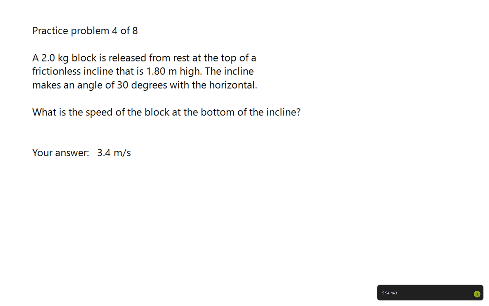

# Wingman

<p align="center">
  
</p>

**It's the Copilot key. It's actually yours now.**

Wingman is a native Windows 11 tray app that lives behind the Copilot key.
Press it, Wingman looks at your screen and hands back one thing: a verdict, a
draft, a filled form, an answer. One press, one action, one card. There is no
chat window, no conversation, no follow-up question: if you want a back and
forth, ChatGPT and Ollama's own app already do that well.



One press on the problem above, and the card in the corner says 5.94 m/s. Click
it and it [shows the working](docs/screenshots/card-expanded.png) it used to get
there. That run went to a local Ollama model, so the screenshot never left the
machine.

## Why not Copilot or Recall?

Sourced from [`docs/positioning.md`](docs/positioning.md); every claim below
about Wingman is checked against the code in this repo, not aspirational.

| | Wingman | Copilot on Windows |
|---|---|---|
| **Footprint** | A tray icon, about 4 MB (3.98 MB measured in CI, with a 4.5 MB limit), 0% CPU until you press the key. No taskbar button, no notifications, no sign-in nags | A taskbar surface, an account wall, a WebView2 app, periodic prompts |
| **Verifiable** | Offline mode refuses any non-loopback network call in code, enforced before a socket ever opens (see [`docs/offline.md`](docs/offline.md)). Open source under MIT: read the code yourself | Copilot Vision sends the screen to Microsoft's servers. Windows Recall shipped plaintext screenshots and had to be pulled twice before relaunching opt-in |
| **Extensible** | An action is a small, readable definition: a prompt, an input list and an executor. More than two dozen built-in actions ship today (check my work, add event from screen, review this email, fill this form, copy text from screen, read QR code from screen, action items to checklist, and more, listed in `docs/actions.md`); a hand-written `actions.toml` entry shows in the palette and runs like a built-in one. The framework is the product, actions are the contribution surface | Closed |
| **Never the final button** | Fills, drafts and proposes. Never presses Send, Submit, Buy or Pay: a permanent rule, not a version-1 limit to be relaxed later | Copilot Actions and other "agent" products sell autonomy |
| **Not a chatbot** | One press, one action, one card, done. No conversation view, no follow-up question | Copilot is a chat pane first, everything else second |
| **Bring your own model** | OpenAI, Anthropic, Gemini, a local Ollama model, or any OpenAI-compatible endpoint (OpenRouter, Groq, LM Studio, llama.cpp, vLLM, ...) today. No account or subscription required for the app itself | Recall and Click to Do require a 40+ TOPS NPU; the strongest models sit behind Copilot Pro |

### What Wingman will never be

- Never a chat window or a conversation history: one press, one action, one
  card.
- Never a follow-up question: the palette filters actions and takes a
  one-line question at most, never a thread.
- Never something you have to type into to get value: pick an action and
  confirm.
- Never the final button: it fills, drafts and proposes, never presses
  Send, Submit, Buy or Pay.

## What works today

Wingman ships more than two dozen built-in actions, all listed in the
palette (the full list is in `actions.example.toml` and
[docs/actions.md](docs/actions.md)). The first of them, built and running:

- **Check my work**: pick it from the options card (or the palette), or set
  `primary_action = "check-my-work"` under `[hotkeys]` so one press of the key
  runs it. Wingman screenshots your active monitor, sends it to a vision model with a prompt tuned for checking a
  hand-worked physics or statistics problem, and shows the verdict as a
  small GDI card in the corner. Click the card for the full working; click
  anywhere else and it goes away. Read-only: it skips Confirm and Do.
- **Add event from screen**: screenshots, proposes a calendar entry, and on
  confirm writes a real `.ics` file via the ics connector.
- **Review this email**: screenshots, proposes edited text, and on confirm
  replaces the selected text via the `replace_text` executor.
- **Fill this form**: screenshots, proposes field values, and on confirm
  fills the form via the `fill_form` executor (with **Restore last form**
  to undo). Goes through the same Look, Propose, Confirm, Do loop as the
  others: `App::on_preview_decided` reads the card's confirmed proposal and
  calls `confirm::confirm(...)` before the executor runs.
- **Copy text from screen**: OCRs the active monitor and copies the text to
  the clipboard.
- **Read QR code from screen**: decodes every QR code on the active
  monitor locally (no model, no network, works in Offline mode) and copies
  the text. A link is shown with its real site and never opened.
- **Relative dates to real dates**: finds phrases like "next Tuesday", "in
  3 days" or "end of the month" in the selection (or on screen) and lists the
  date each one works out to, from today's date on your PC. No model, no
  network. A phrase with two possible readings shows both.

The confirm-and-execute loop, the executors (calendar add, form fill, text
replace, image-to-clipboard) and the actions framework itself
(`actions.toml`, built-in actions loadable today) are built and wired,
not planned. What has landed alongside those actions:

- **Four providers plus any OpenAI-compatible endpoint**: OpenAI, Anthropic
  and Gemini (cloud, your key), Ollama (local, your own machine), and any
  OpenAI-compatible server (OpenRouter, Groq, LM Studio, llama.cpp, vLLM,
  ...). See [`docs/providers.md`](docs/providers.md) for request shapes and
  how to add a compat endpoint to the fallback order today (Settings covers
  OpenAI, Anthropic, Gemini and Ollama).
- **Modes**: Cloud, Local, Auto (default) or Offline, from the tray's
  **Mode** submenu. Offline refuses any non-loopback network call in code;
  see [`docs/offline.md`](docs/offline.md).
- **Pause**: 1 hour, until tomorrow, or until resumed, from the tray's
  **Pause** submenu. While paused the hotkey passes through untouched, no
  capture runs, no request can start.
- **Keys in Windows Credential Manager**, not in `config.toml`: a saved key
  never touches disk in plaintext. See [`docs/providers.md`](docs/providers.md#where-a-key-lives).
- **Retry with backoff**: a transport error or a 5xx retries automatically;
  a 429 retries once against the server's own `retry-after`, or shows a
  card naming the delay.

## Where it's going

The [expansion plan](docs/superpowers/specs/2026-09-16-expansion-plan-design.md)
is the detailed roadmap; the short version is that every action follows the
same four-step loop:

```
   LOOK          PROPOSE              CONFIRM            DO
 screenshot ──▶ model returns a ──▶ preview card, ──▶ executor runs it,
 selection      typed proposal      Enter / Esc        result card
 clipboard      (calendar entry,    (edit fields)      (undo where
 context        form values, ...)                       possible)
```

Read-only actions (like Check my work) skip Confirm and Do and just show the
card. Anything that would write to your screen or a connected service always
waits for your Enter or click first, and Wingman never presses these four
buttons for you:

**Send. Submit. Buy. Pay.**

It fills, drafts and proposes; you finish. That rule is permanent, not a
version-1 limitation to be relaxed later.

Planned and not yet built: more connectors beyond ics, and awareness. The actions-as-data framework, the
confirm-and-execute loop, the built executors and the ics connector are
built; see "What works today" above. Track what remains in
[GitHub Issues](https://github.com/Raaif-Yousuf/Wingman/issues).

## Download

Try Wingman in under two minutes, no Rust and no build step:

1. Download the `.zip` from the [latest release](https://github.com/Raaif-Yousuf/Wingman/releases/latest)
   (named `wingman-<version>-windows-x64.zip`). Its `SHA256SUMS.txt` has the
   checksum to compare against.
2. Unzip it anywhere and run `wingman.exe`. It is a standalone build: no
   installer, no admin rights. This build is not code-signed yet, so Windows
   SmartScreen will likely say it protected your PC; click **More info ▸ Run
   anyway**.
3. A tray icon appears. Press the Copilot key, or `Ctrl+Shift+/` if your
   keyboard does not have or does not emit one (see [Hotkeys](#hotkeys)
   below), to try it.

That is the whole path: the hotkey is a system-wide keyboard hook that works
the moment `wingman.exe` is running, with nothing to register first. What
this download does not do is add Wingman to Start, to the Copilot key picker
in **Settings**, or to start-with-Windows: the zip alone has no Start entry,
no picker entry and no autostart. For that OS-level integration, see
**Install** below, which builds from source: `install.ps1` needs the
`packaging\` folder, which this zip does not include.

## Install

Install is the full-integration path and it builds from source, so it needs a
few things first (the zip above is the quick path and needs none of them):

- A clone of this repository (`git clone https://github.com/Raaif-Yousuf/Wingman`);
  `install.ps1` is in it, not in the zip.
- Rust, from [rustup](https://rustup.rs). `rust-toolchain.toml` pins the
  version and the Windows MSVC target, so the first build downloads that
  toolchain.
- The MSVC build tools, which Rust needs to link ("Desktop development with
  C++" in the Visual Studio Installer).
- The Windows SDK, for `makeappx.exe` and `signtool.exe`, which package and
  sign the app. The "Desktop development with C++" workload includes it. The
  script stops with "Windows SDK not found" if it is missing.

Then, from the cloned folder:

```powershell
.\install.ps1
```

Builds it, puts the `.exe` in `%LOCALAPPDATA%\Programs\Wingman`, registers
it with Windows, and switches on start-with-Windows. Re-run it to upgrade in
place. One UAC prompt the first time, to trust the certificate it signs with;
none after that.

Registering is what puts the app in **Start ▸ All apps**, in
**Settings ▸ Apps ▸ Installed apps**, and in the Copilot key picker described
below. Windows lists only packaged, signed apps in that picker, which is the
whole reason the install does more than copy a file.

`-SkipBuild` uses the existing `target\release\wingman.exe` instead of
running cargo; `-NoAutostart` installs without the login entry.

Nothing in install, upgrade or uninstall reads, writes or deletes your
`config.toml`, so your keys and prompt survive all three.

### Or don't install it

```powershell
cargo build --release
# target\release\wingman.exe
```

The `.exe` is standalone and runs from anywhere with no runtime dependency.
You lose the app lists and the Copilot key picker, and start-with-Windows only
if you tick it yourself in Settings.

## First run

Launch it. A tray icon appears and `%APPDATA%\Wingman\config.toml` is
created. Left-click the tray icon to open **Settings**, and paste your key
into **OpenAI API key** or **Anthropic API key**, both in the Providers group
at the top. Everything else lives there too: model, thinking time,
screenshot detail, card corner, monitor and timeout, and the prompt. A saved key moves into Windows
Credential Manager, not the file; Settings shows only its last four
characters afterward.

No key but Ollama running on this PC? The first press of the Wingman key (or
"What can I do here?" in the tray) finds a model that can read images, saves
it as your setup and says so on the card. It does not ask yet: press again to
ask it. If it finds nothing, the card lists what works without a model and ends
with **Set up a model**, which opens Settings (press its number, or click it).
Nothing is sent and nothing is billed until you pick an option.

Settings has key and model fields for OpenAI, Anthropic and Gemini (with a
key saved, opening Settings asks the provider for its current model list, so
a new model shows up on its own; this is skipped in Offline mode), a model
list for Ollama (models you have pulled, with "(vision)" on the ones that can
read images), and an Active provider choice. A Gemini key on its own is
enough. If you also have an OpenAI or Anthropic key, Gemini is not tried unless
you pick it as the Active provider. The tray's Provider menu picks the
active provider too. An OpenAI-compatible endpoint still needs a hand-edit of
`config.toml`; see
[`docs/providers.md`](docs/providers.md#how-to-add-ollama-gemini-or-a-compat-endpoint-to-providersorder-by-hand-today)
for the steps.

Local (Ollama) and Offline are both real options now, via the tray's
**Mode** submenu: Cloud, Local, Auto (default: local first if Ollama is up,
otherwise cloud) or Offline (loopback only, enforced in code). See
[`docs/offline.md`](docs/offline.md) for exactly what each mode does.

The config file is still there (`Open config.toml` in the tray menu) if you
want to edit it by hand. If it has a mistake that stops it parsing, Wingman
starts in Offline mode, tells you so on a card, and does not save over the
file; fix it and choose **Reload settings**. Settings also refuses to save
over a file that changed while it was open, and one backup copy
(`config.toml.bak`, keys blanked) is kept before a save replaces the file. See
[`docs/offline.md`](docs/offline.md#a-config-file-that-does-not-parse).

`OPENAI_API_KEY` / `ANTHROPIC_API_KEY` / `GEMINI_API_KEY` in the environment
override the file, so you can keep keys out of the config entirely if you
prefer.

Configure one cloud provider or several. With more than one set, the rest
are the automatic fallback in `providers.order` when the first fails: a
provider with an empty key is skipped, not treated as an error.

Switch models from the tray at any time; the choice is written straight back
to the config. To offer a model that isn't listed, add it to `models` under
the relevant provider; no rebuild needed.

## Hotkeys

Two bindings, both live at once:

| | default | notes |
|---|---|---|
| primary | the Copilot key | Windows emits it as `Win+Shift+F23` |
| secondary | `Ctrl+Shift+/` | works on any keyboard |

One press of the primary key shows the options card: a few choices for what
is on your screen. Press the key once while the card is up to run the first
choice, or twice quickly to run the second (never one that writes to the
clipboard; the key closes the card instead). A press while an answer card is
showing closes it. Under `[hotkeys]` in `config.toml`, `key_mode` is
`"dynamic"` (the default), `"pick"` (the key never closes an answer card) or
`"close"` (the key only ever closes a card), and `double_press_ms` (default
300, from 150 to 600) is how fast the second press must come; `0` turns
double press off, so the first press acts at once. To make
one press run a single action instead, set `primary_action` under `[hotkeys]`
in `config.toml`:

| `primary_action` | what one press does |
|---|---|
| `"options"` (default) | shows the options card |
| `"check-my-work"` | runs Check my work at once, as before |
| any other action id | runs that action at once, with no options card |

An id that no action has is named on a card once. After that the key shows the
options card.

If the Copilot key does nothing, use **Set Copilot key...** in the tray menu
and press it once: whatever your firmware actually emits gets captured and
saved. Same for the secondary binding.

A third, optional chord toggles Pause: running -> paused until resumed;
paused, for any reason -> resume. Unlike primary/secondary it has no default
binding. Use **Set pause key...** in the tray menu and press the key, or set
it by hand in `config.toml`:

```toml
[hotkeys.pause]
vk = 0x13    # VK_PAUSE
ctrl = false
shift = false
alt = false
win = false
```

then **Reload settings** (or restart) to pick it up. The tray label shows
the current key, or "not set". To clear it, delete the `[hotkeys.pause]`
table from `config.toml` and choose **Reload settings**. It is the one chord
that still works while paused.

### Through Windows Settings instead

Once installed, Wingman can also be made the Copilot key's target the
official way:

**Settings ▸ Bluetooth & devices ▸ Keyboard ▸ Customize Copilot key on
keyboard ▸ Custom ▸ Wingman**

You have to click that yourself. Windows protects
the setting so no app can make itself the target, which is the right call,
and means an installer cannot do it for you however much it would like to.

Both routes work at once and do the same thing. The difference is that this
one is Windows launching the app, so it works regardless of what the keyboard
hook sees; the hook is still what serves the secondary binding.

One gap worth knowing: if Wingman is **not already running**, a key press
starts it and stops there rather than asking. That is deliberate: the same
bare launch is what runs at login, and asking on it would mean a billed API
call every boot. With start-with-Windows on it is always running anyway.

## Tray icon

The icon shows what Wingman is doing: an orange dot while a request is in
flight, grey while paused, a blue tint in Offline mode, and a red dot after a
run failed (it clears when you start the next one). The tooltip says the same
in words.

## Keys on the card

On an open answer card, `C` or `Ctrl+C` copies the text, and `Ctrl+Shift+C`
copies the card as an image. `Tab` moves between the footer links, `Enter` or
`Space` runs the one that has focus, and `Esc` closes the card.

## Cost on the card

A cloud answer ends with a small line such as `About $0.002`: what that answer
cost, from the same price table as the tray tooltip and the egress log. Local
models show nothing, and so does a model with no listed price (a made-up
number would be worse). If a fallback model answered, the same line also says
which one.

## Tray menu

- A greyed first line with the running version
- **Ask now (same as the key)**: trigger without the hotkey
- **Actions ▸**: **Quick Ask (pick an action)** (a palette of every action)
  plus each action directly: copy text, read a QR code, copy a region,
  calculate, add an event, review an email, fill a form, restore the last form
- **Copy last answer**: headline and working to the clipboard
- **Pause ▸**: 1 hour / until tomorrow / until resumed; shown as **Resume**
  instead while already paused
- **Mode ▸**: Cloud / Local / Auto / Offline, radio-checked
- **Providers and keys ▸**: **Provider** (which service answers),
  **ChatGPT model** / **Claude model** / **Ollama model** (saved
  immediately), and **Set
  Copilot key...** / **Set secondary key...** / **Set pause key...** to
  rebind by pressing the key
- **Settings...**: the settings window (left-clicking the tray icon opens
  this too)
- **Help and diagnostics ▸**: open `config.toml`, import or export an action
  as a file, reload settings, copy diagnostics, copy the egress log, check
  this PC for local models
- **Quit**

## Settings worth knowing

| key | default | what it does |
|---|---|---|
| `mode` | `"auto"` | `cloud` / `local` / `auto` / `offline`; see [`docs/offline.md`](docs/offline.md) |
| `budget.daily_usd` | `0` (off) | daily limit in US dollars for cloud requests. A notice shows at `budget.warn_percent` (80) and at the limit; past it, cloud requests are refused with a card and local models still work. Counts from the same totals as the tray tooltip, so unpriced models are not included |
| `capture.max_edge` | `1568` | long-edge downscale before upload; lower cuts cost |
| `capture.monitor` | `"active"` | `"active"` follows the focused window; `"primary"` pins it |
| `capture.redact` | `true` | one switch, also a checkbox in Settings. When on: card numbers, IBANs, key-like tokens, email addresses and password fields are painted over in the screenshot before a cloud or remote request; the same details in any text sent too (selected text, page text, field values) become numbered markers such as `[email 1]`; and the real values are put back into the answer. The screenshot step adds about 0.2 to 0.3 s. Requests to 127.0.0.1 skip it. If the screenshot check cannot run, nothing is sent |
| `capture.extra_password_managers` | `[]` | program names such as `"myvault.exe"` to add to the built-in list (1Password, Bitwarden, KeePass, KeePassXC, LastPass, Dashlane, Keeper, NordPass, Proton Pass, Enpass, RoboForm). While one is the front window, a key press shows a card and Wingman captures and sends nothing. A password manager that is only visible beside the front window is still in the screenshot; Store versions are not recognised |
| `egress_preview.enabled` | `false` | before any request leaves this computer, show a card with what will be sent (the image size, the prompt and the text) and the provider it goes to; **Send** sends it, Esc cancels and nothing is sent. Requests to Ollama on 127.0.0.1 stay on this machine and are not shown. Opening the Quick Ask palette sends nothing |
| `providers.order` | `["openai", "anthropic"]` | fallback order; Settings and the tray set the first entry; add `"compat:<name>"` by hand, see [`docs/providers.md`](docs/providers.md) |
| `providers.*.effort` | `"low"` | reasoning depth; raise for harder problems |
| `providers.ollama.base_url` | `"http://127.0.0.1:11434"` | never `localhost`, see [`docs/providers.md`](docs/providers.md#ollama) |
| `options.max_options` | `4` | how many options the model is asked to write. Only the first is acted on today; the options card ([#305](https://github.com/Raaif-Yousuf/Wingman/issues/305)) will show them all |
| `ui.card_seconds` | `12` | auto-dismiss for the collapsed card; `0` = never |
| `ui.text_scale` | `1.0` | multiplies the card's font size; lower is smaller |
| `ui.card_corner` | `"bottom_right"` | where the card sits: `bottom_right`, `bottom_left`, `top_right`, `top_left`, or `follow_mouse` (next to the pointer) |
| `ui.card_monitor` | `"cursor"` | which monitor the card appears on: `"cursor"` (the one the mouse is on), `"primary"`, or `"1"`, `"2"`, ... counting monitors left to right (not the numbers in Windows Settings, and they shift if you rearrange or dock monitors). Ignored by `follow_mouse` |
| `providers.*.models` | see file | what the tray's model submenu offers (Ollama has no list; it uses `providers.ollama.model` directly) |
| `ui.prompt` | see file | the system prompt, edit it to change what it checks |
| `hotkeys.pause` | unset (absent from the file) | optional third chord: toggles Pause until resumed / Resume; no default, learnable from the tray's **Set pause key...**, see [Hotkeys](#hotkeys) |

Roughly 1-2 cents and 3-8 seconds per check at the defaults.

## Start with Windows

`install.ps1` turns this on for you. Otherwise, tick **Start with Windows** in
Settings; same entry, same effect. It writes a per-user entry to
`HKCU\Software\Microsoft\Windows\CurrentVersion\Run`, no admin prompt, and it
shows up in Task Manager's Startup tab like any other startup app. Untick to
remove it.

The checkbox reads the registry when Settings opens, so it always reflects
reality rather than a mirrored setting that can drift. If you move or rebuild
the exe somewhere else, the entry is repaired to the new path on next launch.

## Portable mode

Put an empty file named `wingman.portable` next to `wingman.exe` and restart.
Wingman then keeps its settings, store and logs in a `Wingman` folder next to
the exe (calendar temp files included), and makes no registry writes: Start with Windows is off and greyed
out. Delete the marker to go back to the normal folders (your files are not
moved either way).

API keys still live in Windows Credential Manager on each PC, never in that
folder, so a copy on a new PC starts without keys. Set them again, or use the
`OPENAI_API_KEY`, `ANTHROPIC_API_KEY` and `GEMINI_API_KEY` environment
variables. The owner-only file restriction is skipped in portable mode (the
drive moves between PCs and users, and FAT or exFAT has no file permissions),
so the folder keeps the drive's own permissions: keep the drive private. A key
you typed into the config file by hand would sit there in plain text. The
marker is ignored when the exe is under `Program Files` or `WindowsApps`.

## Only one instance

Launching it again while it is already running does not start a second copy:
the new process hands over to the running one, which opens its Settings
window, then exits. Without that, two instances mean two tray icons, two
keyboard hooks and **two billed API calls per keypress**, with nothing in the
UI to hint at it.

If you kill it with Task Manager rather than **Quit**, the tray icon can
linger as a ghost until you mouse over it: the process never got to remove
it.

## Uninstall

```powershell
.\uninstall.ps1
```

Stops it, unregisters the package, clears the autostart entry, hands the
Copilot key back to Search if it was pointed here, deletes
`%LOCALAPPDATA%\Programs\Wingman`, and removes the signing certificate
from both stores. One UAC prompt, for that last part; `-KeepCertificate`
skips it, which is what you want if you are about to reinstall. It also
cleans up a pre-rename `copilot-ask` install left over from before the
2026-09-16 rename, if one is still on the machine.

Since it is a registered app you can also use **Settings ▸ Apps ▸ Installed
apps ▸ Wingman ▸ Uninstall**. That removes the package but leaves the
autostart entry, the certificate and the installed folder behind, so the
script is the tidier route.

Either way your config is left alone, deliberately: it holds your API keys
and your prompt, and throwing those away is your call:

```powershell
Remove-Item "$env:APPDATA\Wingman" -Recurse -Force
```

Rotate any API key that was in it; deleting the file does not invalidate it.

Then delete the project folder. Nothing else is written anywhere: no Program
Files, no services, no scheduled tasks, no shell extensions.

## Promises

What Wingman commits to, and how each promise is enforced or verifiable
today: [`PROMISES.md`](PROMISES.md).

## Privacy and security

What leaves the machine, when, and how to wipe local state is in
[`PRIVACY.md`](PRIVACY.md). To report a security issue, see
[`SECURITY.md`](SECURITY.md).

## How Wingman is built

Wingman is built by me with Claude Code as a coding assistant. I decide what
gets built, review every change, and read every message before it's posted.
If something reads wrong, that's on me, and I'd like to hear about it.

## Contributing

Wingman is meant to grow by community-contributed actions: a prompt, an
input list and (usually) an existing executor. See
[`CONTRIBUTING.md`](CONTRIBUTING.md) for the "add an action" walkthrough, and
[`CODE_OF_CONDUCT.md`](CODE_OF_CONDUCT.md) for how we expect people to treat
each other here.

## Design

Architecture, request shapes and the Win32 details of what is built today are
in
[`docs/superpowers/specs/2026-09-14-copilot-ask-design.md`](docs/superpowers/specs/2026-09-14-copilot-ask-design.md).
Packaging and install internals are in the
[packaging spec](docs/superpowers/specs/2026-09-15-packaging-and-install-design.md).
What comes next, in full, is the
[expansion plan](docs/superpowers/specs/2026-09-16-expansion-plan-design.md).
Per-provider request shapes, keys and retry behaviour are in
[`docs/providers.md`](docs/providers.md); the four modes and the Offline
guard are in [`docs/offline.md`](docs/offline.md).

## License

MIT, see [`LICENSE`](LICENSE). Third-party dependencies and their licenses are
listed in [`THIRD_PARTY_NOTICES.md`](THIRD_PARTY_NOTICES.md).
